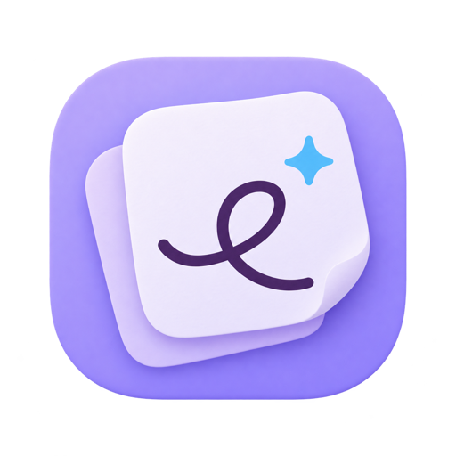
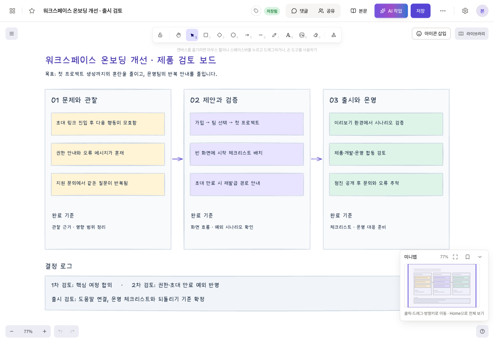
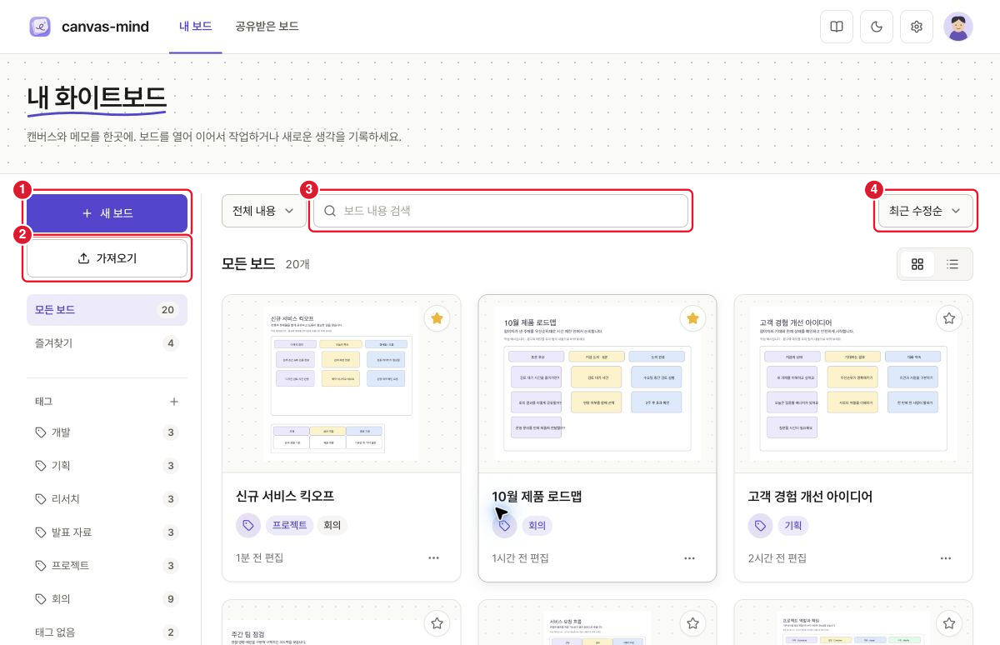
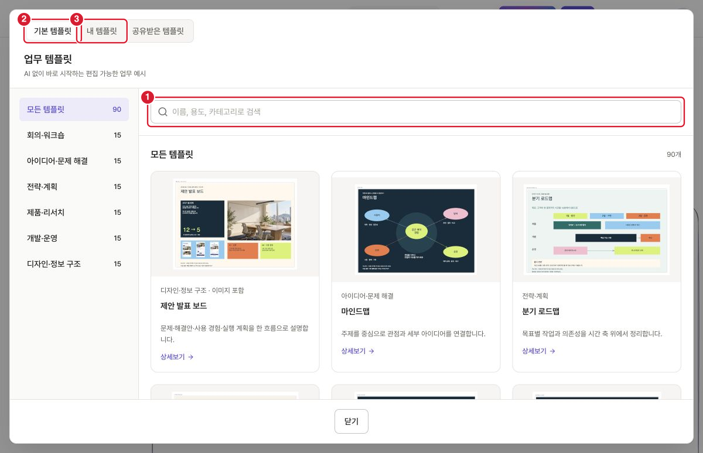
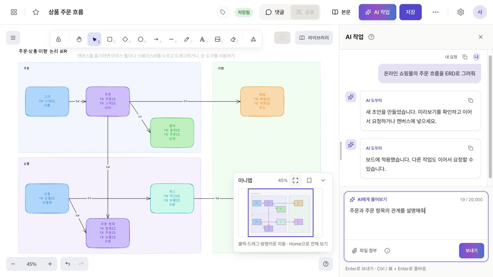
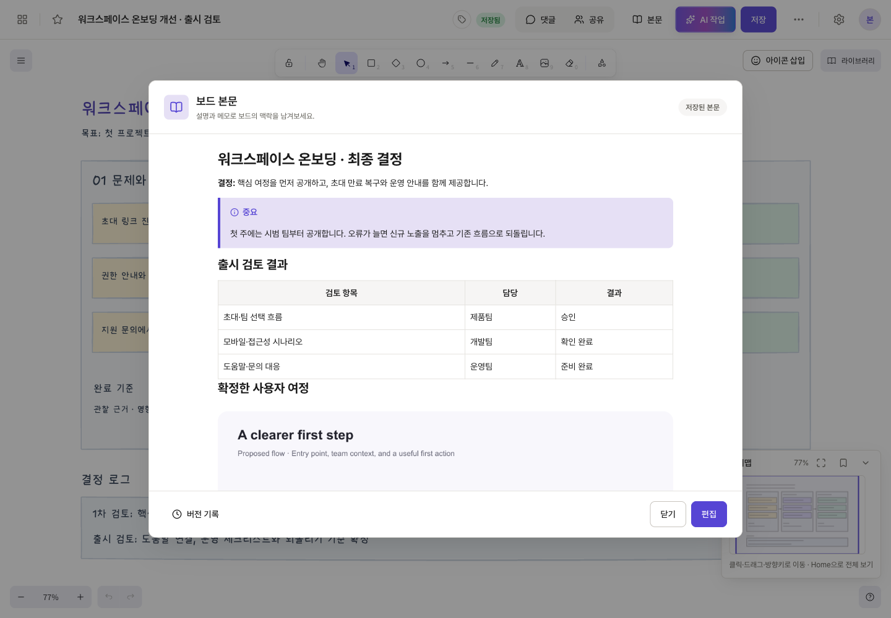
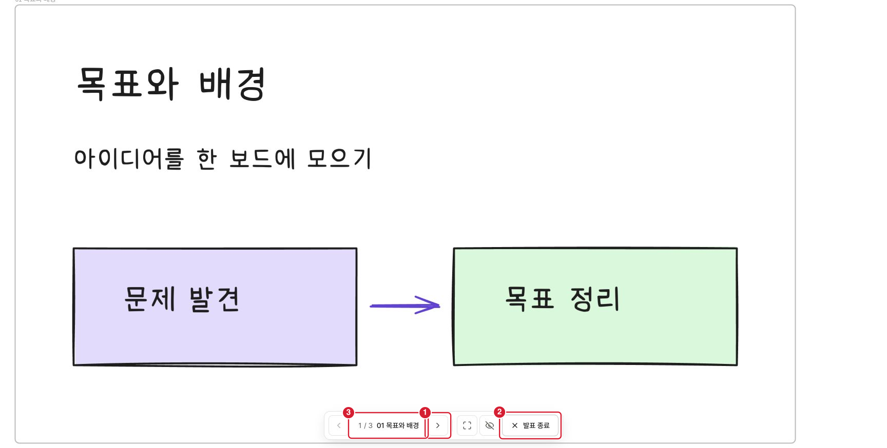
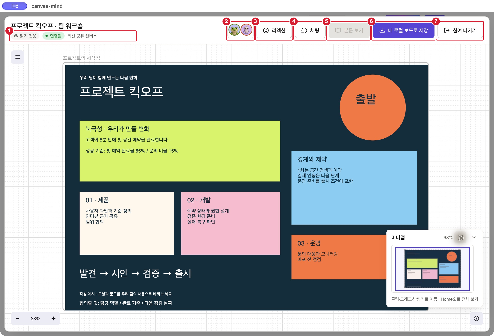

  

  <h1>canvas-mind</h1>

  

    <strong>생각을 그리고, 함께 정리하는 화이트보드</strong> 
    아이디어 스케치부터 업무 흐름, 회의 기록, 발표까지 한 보드에서 이어갑니다.
  

  

    <a href="https://canvas-mind.vercel.app"><strong>웹에서 시작하기</strong></a> ·
    <a href="https://github.com/wally-wally/canvas-mind-release/releases"><strong>데스크톱 다운로드</strong></a> ·
    <a href="https://canvas-mind-docs.vercel.app"><strong>공식 이용 가이드</strong></a>
  

**canvas-mind**는 자유롭게 그리고, 글로 설명을 덧붙이고, 다른 사람과 의견을 나눌 수 있는 화이트보드 서비스입니다. 도형·화살표·텍스트·이미지로 생각을 펼치고, 템플릿이나 AI의 도움으로 첫 초안을 만들 수 있습니다.

브라우저에서 시작하거나 데스크톱 앱에서 이용할 수 있습니다. 데스크톱의 로컬 모드에서는 로그인 없이 내 컴퓨터에 보드를 저장하고 오프라인으로 편집할 수 있습니다.

## 이런 분께 추천합니다

| 이런 작업을 한다면            | 이렇게 활용해 보세요                                                                 |
| ----------------------------- | ------------------------------------------------------------------------------------ |
| **기획자·PM**                 | 서비스 흐름, 고객 여정, 제품 로드맵을 한눈에 정리하고 결정 이유를 본문에 기록합니다. |
| **디자이너·개발자**           | 화면 구성과 기능 간 관계를 스케치하고, 필요한 위치에 댓글을 남겨 검토합니다.         |
| **회의·워크숍을 진행하는 팀** | 킥오프, 브레인스토밍, 회고 템플릿으로 대화를 시작하고 보드를 발표 자료로 활용합니다. |
| **교육자·학습자**             | 개념 사이의 관계를 그림으로 연결하고, 설명과 참고 자료를 함께 정리합니다.            |
| **개인 프로젝트를 하는 분**   | 아이디어와 할 일을 보드별로 모으고, 태그와 즐겨찾기로 다시 찾아봅니다.               |

## 화면으로 살펴보기

아래는 예시 데이터를 사용한 실제 앱 화면입니다. 이미지를 누르면 크게 볼 수 있습니다. 일부 화면의 빨간 번호는 이용 가이드의 설명 표시입니다.

| 🗂️ 보드와 아이디어 모아 보기                                                                                                             | 🧩 템플릿으로 시작하기                                                                                                          |
| ---------------------------------------------------------------------------------------------------------------------------------------- | ------------------------------------------------------------------------------------------------------------------------------- |
|  |  |
| 보드를 썸네일로 살펴보고 검색·태그·즐겨찾기로 정리합니다.                                                                                | 로드맵, 마인드맵, 발표 등 다양한 예시를 내 작업에 맞게 바꿉니다.                                                                |

| ✨ AI와 함께 초안 다듬기                                                                                                                | 📝 그림에 설명 더하기                                                                                                               |
| --------------------------------------------------------------------------------------------------------------------------------------- | ----------------------------------------------------------------------------------------------------------------------------------- |
|  |  |
| 원하는 내용을 말로 요청하고, 결과를 확인한 뒤 보드에 적용합니다.                                                                        | 배경, 결정 사항, 체크리스트를 보드 본문에 함께 남깁니다.                                                                            |

| 🎞️ 보드를 발표로 이어가기                                                                                                              | 💻 같은 공간에서 보드 나누기                                                                                                                                   |
| -------------------------------------------------------------------------------------------------------------------------------------- | -------------------------------------------------------------------------------------------------------------------------------------------------------------- |
|  |  |
| 프레임의 순서를 정하고 필요한 내용에 집중해 설명합니다.                                                                                | 데스크톱 로컬 공유로 같은 네트워크의 참여자와 보드를 보며 의견을 나눕니다.                                                                                     |

## 주요 기능

| 기능                      | 할 수 있는 일                                                                                                                                 |
| ------------------------- | --------------------------------------------------------------------------------------------------------------------------------------------- |
| ✏️ **자유로운 캔버스**    | 도형, 화살표, 텍스트, 이미지로 아이디어를 표현합니다. 아이콘과 도형 라이브러리를 활용하고 밝은 화면·어두운 화면을 선택할 수 있습니다.         |
| 🧭 **넓은 보드 탐색**     | 미니맵으로 원하는 위치로 이동하고, 자주 보는 화면을 북마크로 남깁니다.                                                                        |
| 🗂️ **보드 정리**          | 카드·목록 보기, 검색, 태그, 즐겨찾기로 여러 작업을 관리합니다.                                                                                |
| 🧩 **업무 템플릿**        | 준비된 템플릿을 미리 보고 추가하거나, 자주 쓰는 구성을 내 템플릿으로 저장합니다.                                                              |
| ✨ **AI 작업**            | 자연어로 새 그림이나 기존 보드의 수정을 요청합니다. 대화로 초안을 다듬고 미리보기에서 확인한 뒤 적용합니다.                                   |
| 📝 **보드 본문**          | Markdown으로 설명과 체크리스트를 작성하고 이미지를 첨부합니다. 본문 버전 기록에서 이전 내용을 확인하고 복원할 수 있습니다.                    |
| 🔗 **공유와 피드백**      | 온라인 보드를 읽기 전용 링크로 공유합니다. 댓글 참여가 허용된 보드에서는 위치별 댓글, 답글, 이모지 반응으로 의견을 나눕니다.                  |
| 🎞️ **프레임 발표**        | 보드의 프레임을 발표 단위로 묶고 순서를 정해 한 장씩 보여 줍니다.                                                                             |
| 📦 **가져오기·내보내기**  | Excalidraw 파일을 가져오고, 보드를 이미지·PDF·PPTX 등으로 내보냅니다. PPTX는 지원되는 도형과 텍스트를 PowerPoint에서 다시 편집할 수 있습니다. |
| 💻 **데스크톱 로컬 작업** | 내 컴퓨터에 보드를 저장하고 오프라인으로 편집합니다. 같은 네트워크에서는 로컬 공유와 채팅·리액션·투표를 활용할 수 있습니다.                   |

AI는 선택 기능입니다. 직접 그리거나 템플릿으로 시작해도 됩니다. AI 이용에는 인터넷 연결과 이용 방식에 맞는 설정이 필요하며, 제공 범위와 사용 한도는 [공식 이용 가이드](https://canvas-mind-docs.vercel.app)에서 확인할 수 있습니다.

## 웹과 데스크톱 이용 방식

| 이용 방식                  | 이런 상황에 어울립니다                        | 보드 이용                                        |
| -------------------------- | --------------------------------------------- | ------------------------------------------------ |
| **웹**                     | 설치 없이 브라우저에서 시작할 때              | 로그인한 계정의 온라인 보드를 이용합니다.        |
| **데스크톱 · 온라인 모드** | 별도 앱에서 온라인 작업을 이어갈 때           | 웹에서 사용하던 계정의 온라인 보드를 이용합니다. |
| **데스크톱 · 로컬 모드**   | 내 컴퓨터에 보관하거나 오프라인에서 작업할 때 | 로그인 없이 로컬 보드를 만들고 편집합니다.       |

> [!NOTE]
> 로컬 보드는 온라인 보드나 다른 기기로 자동 동기화되지 않습니다. 온라인으로 옮길 때는 별도 가져오기를 이용합니다. 캔버스는 자동 저장되며, 본문을 수정한 뒤에는 **본문 저장**을 눌러 주세요.

## 시작하기

### 웹에서 이용

[canvas-mind 웹 앱](https://canvas-mind.vercel.app)에 접속해 로그인한 뒤 보드를 만들어 보세요. 빈 캔버스에 직접 그리거나, 템플릿을 골라 첫 작업을 시작할 수 있습니다.

### 데스크톱 앱 다운로드

[GitHub Releases](https://github.com/wally-wally/canvas-mind-release/releases)에서 공개된 버전의 설치 파일을 내려받을 수 있습니다. 릴리스 안내에서 지원 운영체제와 설치 방법을 확인하고, 내 컴퓨터에 맞는 파일을 선택해 주세요.

설치 파일은 버전이 공개되는 대로 제공됩니다. 아직 다운로드할 릴리스가 없다면 웹 앱을 먼저 이용해 주세요.

### 자세한 사용법

[공식 이용 가이드](https://canvas-mind-docs.vercel.app)에서 보드 만들기, 캔버스 편집, AI 작업, 공유, 발표, 데스크톱 이용 방법을 실제 화면과 함께 확인할 수 있습니다.

---

  <strong>떠오른 생각을, 다음 행동으로.</strong> 
  <a href="https://canvas-mind.vercel.app">웹에서 시작하기</a> ·
  <a href="https://github.com/wally-wally/canvas-mind-release/releases">데스크톱 다운로드</a> ·
  <a href="https://canvas-mind-docs.vercel.app">공식 이용 가이드</a>

