

  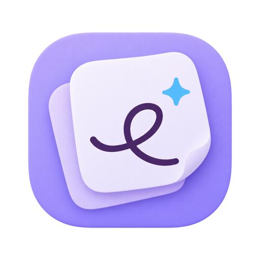

  <h1>canvas-mind</h1>

  

    <strong>생각을 그리고, 함께 정리하는 화이트보드</strong> 
    아이디어 스케치부터 업무 흐름, 회의 기록, 발표까지 한 보드에서 이어갑니다.
  

  

    <a href="https://canvas-mind.vercel.app"><strong>웹에서 시작하기</strong></a> ·
    <a href="https://github.com/wally-wally/canvas-mind-release/releases"><strong>데스크톱 다운로드</strong></a> ·
    <a href="https://canvas-mind-docs.vercel.app"><strong>공식 이용 가이드</strong></a>
  

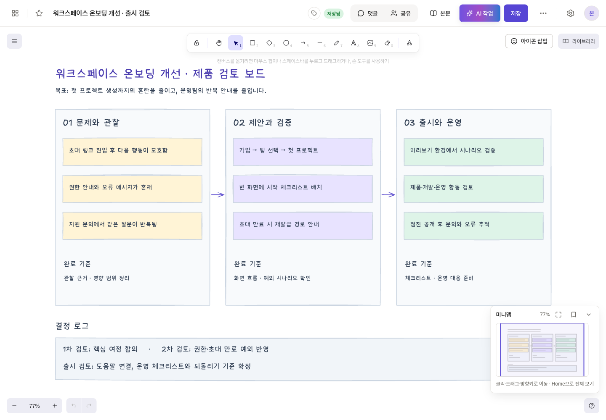

**canvas-mind**는 자유롭게 그리고, 글로 설명을 덧붙이고, 다른 사람과 함께 편집할 수 있는 화이트보드 서비스입니다. 도형·화살표·텍스트·이미지로 생각을 펼치고, 템플릿이나 AI의 도움으로 첫 초안을 만들 수 있습니다. 완성한 보드는 발표자 노트를 보며 발표하거나, 편집 가능한 PowerPoint 자료로 이어갈 수 있습니다.

브라우저에서 시작하거나 데스크톱 앱에서 이용할 수 있습니다. 데스크톱의 로컬 모드에서는 로그인 없이 내 컴퓨터에 보드를 저장하고 오프라인으로 편집할 수 있습니다.

## 이런 분께 추천합니다

| 이런 작업을 한다면            | 이렇게 활용해 보세요                                                                 |
| ----------------------------- | ------------------------------------------------------------------------------------ |
| **기획자·PM**                 | 서비스 흐름, 고객 여정, 제품 로드맵을 한눈에 정리하고 결정 이유를 본문에 기록합니다. |
| **디자이너·개발자**           | 화면 구성과 기능 간 관계를 함께 그리거나, 필요한 위치에 댓글을 남겨 검토합니다.      |
| **회의·워크숍을 진행하는 팀** | 킥오프, 브레인스토밍, 회고 템플릿으로 대화를 시작하고 보드를 발표 자료로 활용합니다. |
| **교육자·학습자**             | 개념 사이의 관계를 그림으로 연결하고, 설명과 참고 자료를 함께 정리합니다.            |
| **개인 프로젝트를 하는 분**   | 아이디어와 할 일을 보드별로 모으고, 태그와 즐겨찾기로 다시 찾아봅니다.               |

## 화면으로 살펴보기

아래는 예시 데이터를 사용한 실제 앱과 내보낸 파일 화면입니다. 이미지를 누르면 크게 볼 수 있습니다. 일부 화면의 빨간 번호는 이용 가이드의 설명 표시입니다.

| 🗂️ 보드와 아이디어 모아 보기                                                                                                             | 🧩 템플릿으로 시작하기                                                                                                          |
| ---------------------------------------------------------------------------------------------------------------------------------------- | ------------------------------------------------------------------------------------------------------------------------------- |
| [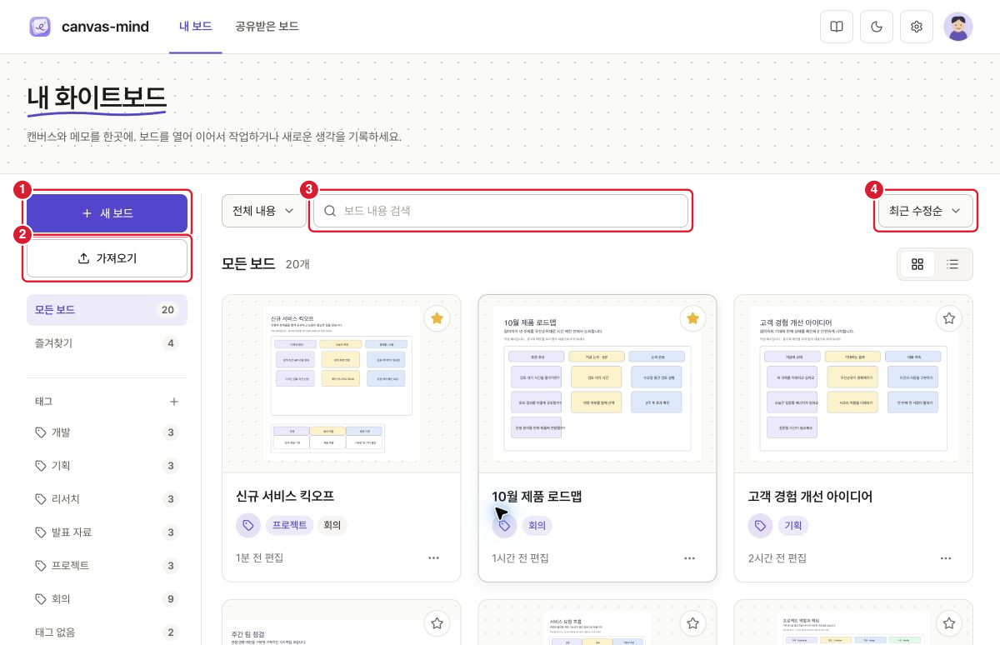](assets/screenshots/board-library.png) | [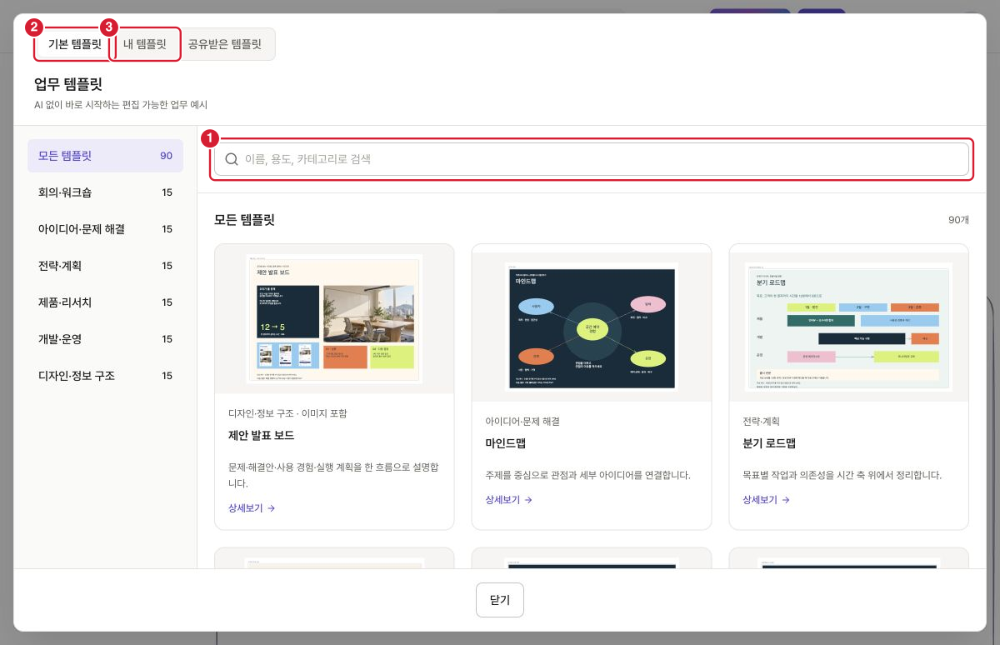](assets/screenshots/template-library.png) |
| 보드를 썸네일로 살펴보고 검색·태그·즐겨찾기로 정리합니다.                                                                                | 로드맵, 마인드맵, 발표 등 다양한 예시를 내 작업에 맞게 바꿉니다.                                                                |

| 🤝 온라인에서 함께 편집하기                                                                                                                                                   | ✨ AI와 함께 초안 다듬기                                                                                                                |
| ----------------------------------------------------------------------------------------------------------------------------------------------------------------------------- | --------------------------------------------------------------------------------------------------------------------------------------- |
| [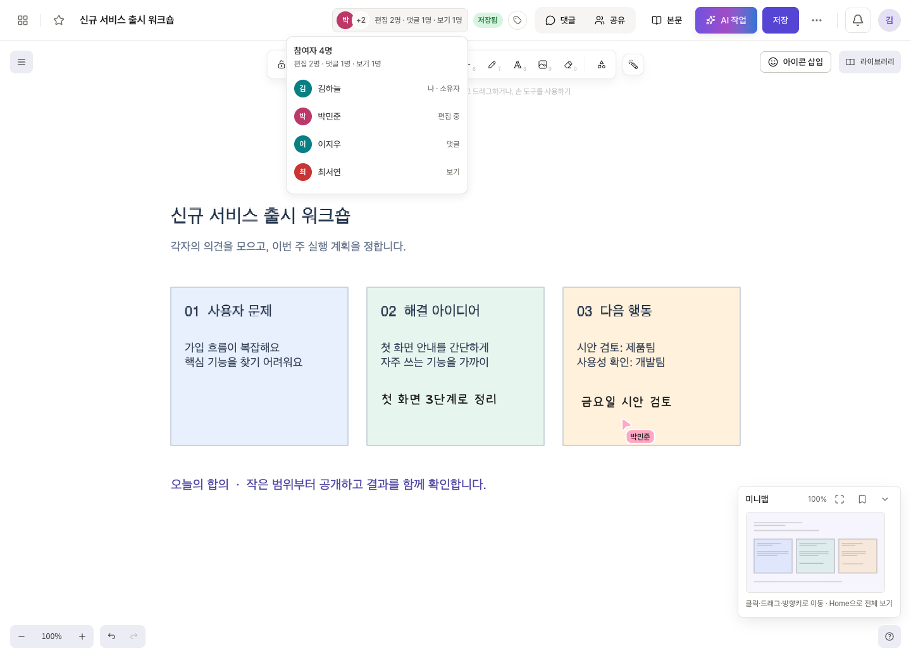](assets/screenshots/online-collaboration.png) | [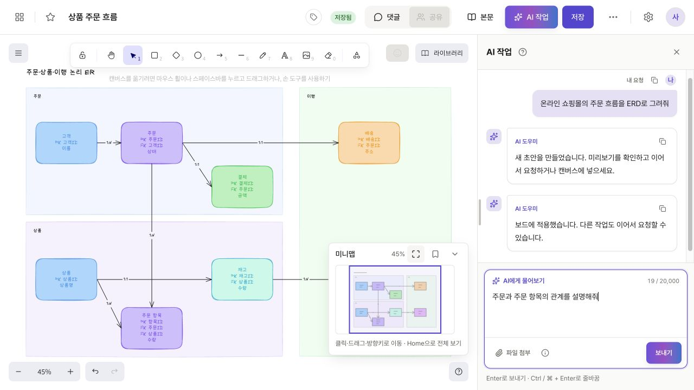](assets/screenshots/ai-workspace.png) |
| 사람별 보기·댓글·편집 권한을 정하고, 같은 캔버스의 변경을 실시간으로 확인합니다.                                                                                              | 원하는 내용을 말로 요청하고, 결과를 확인한 뒤 보드에 적용합니다.                                                                        |

| 📝 그림에 설명 더하기                                                                                                                                            | 🎞️ 노트를 보며 발표하기                                                                                                                                         |
| ---------------------------------------------------------------------------------------------------------------------------------------------------------------- | --------------------------------------------------------------------------------------------------------------------------------------------------------------- |
| [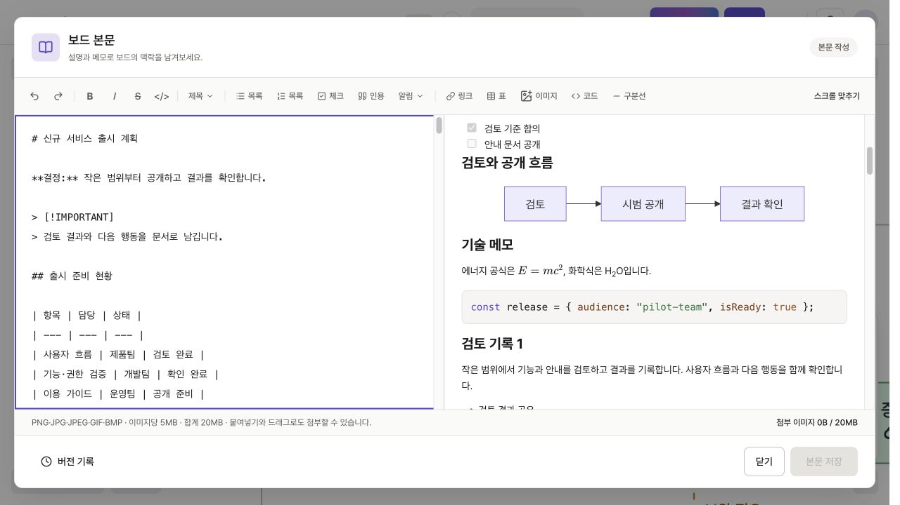](assets/screenshots/board-notes.png) | [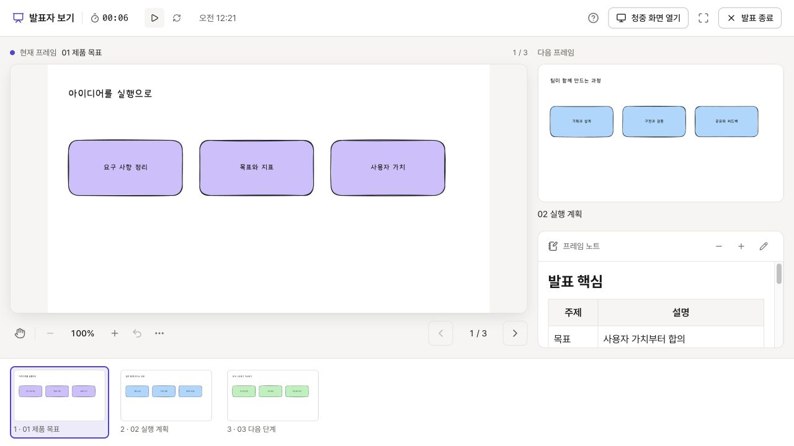](assets/screenshots/frame-presentation.png) |
| 결정 사항과 체크리스트를 기록하고, 긴 문서도 미리보기를 스크롤하며 읽습니다.                                                                                     | 발표자는 노트와 다음 프레임을 확인하고, 청중에게는 현재 프레임을 별도 창으로 보여 줍니다.                                                                       |

| 📊 PowerPoint에서 이어서 편집하기                                                                                                                             | 💻 같은 공간에서 보드 나누기                                                                                                                                   |
| ------------------------------------------------------------------------------------------------------------------------------------------------------------- | -------------------------------------------------------------------------------------------------------------------------------------------------------------- |
| [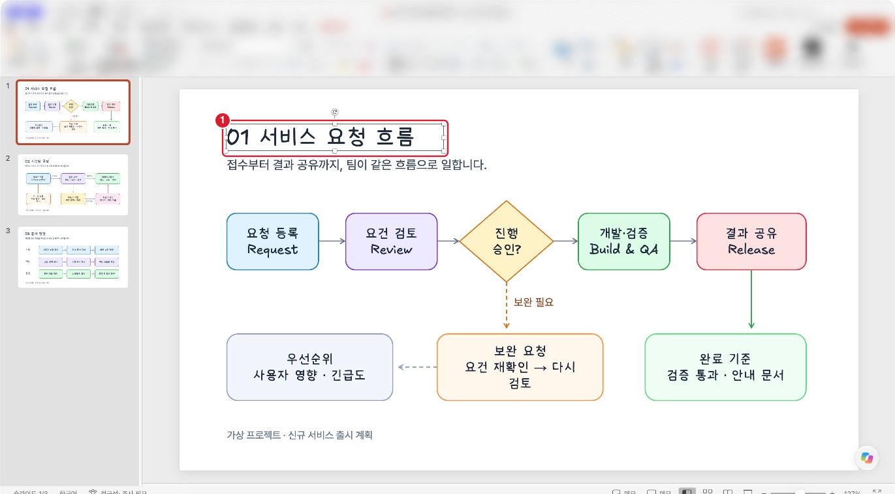](assets/screenshots/powerpoint-export.png) | [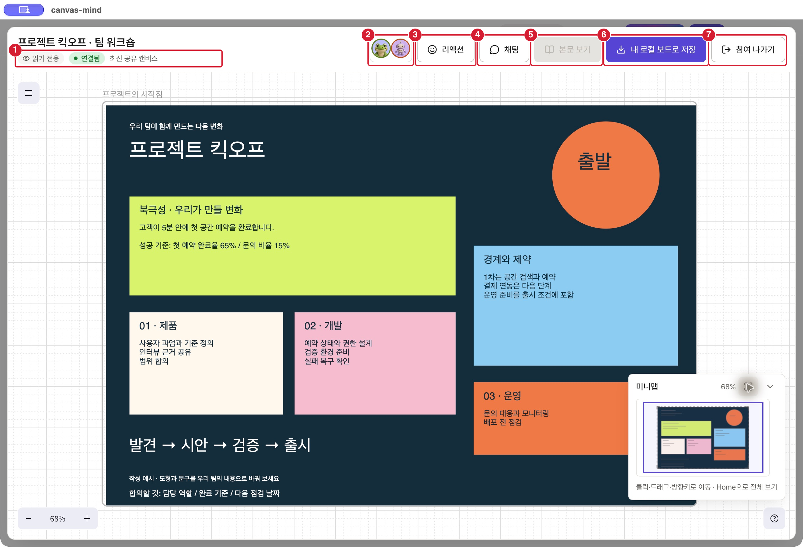](assets/screenshots/desktop-sharing.png) |
| 지원되는 도형·텍스트·화살표를 편집 가능한 PPTX로 내보내고, 프레임 노트도 발표자 노트로 전달합니다.                                                            | 데스크톱 로컬 공유로 같은 네트워크의 참여자와 보드를 보며 의견을 나눕니다.                                                                                     |

| 🔌 외부 AI와 로컬 보드 연결하기                                                                                                                         | 🔔 댓글과 공유 소식 확인하기                                                                                                                              |
| ------------------------------------------------------------------------------------------------------------------------------------------------------- | --------------------------------------------------------------------------------------------------------------------------------------------------------- |
| [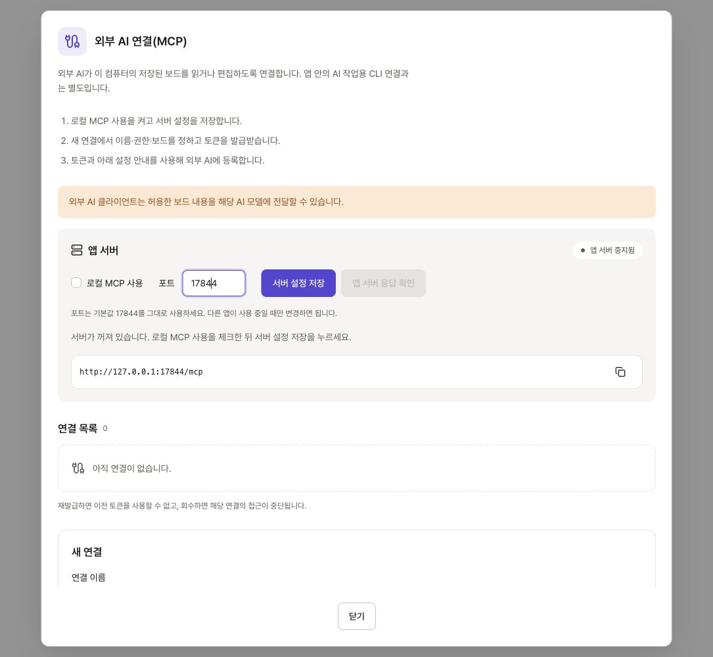](assets/screenshots/desktop-local-mcp.png) | [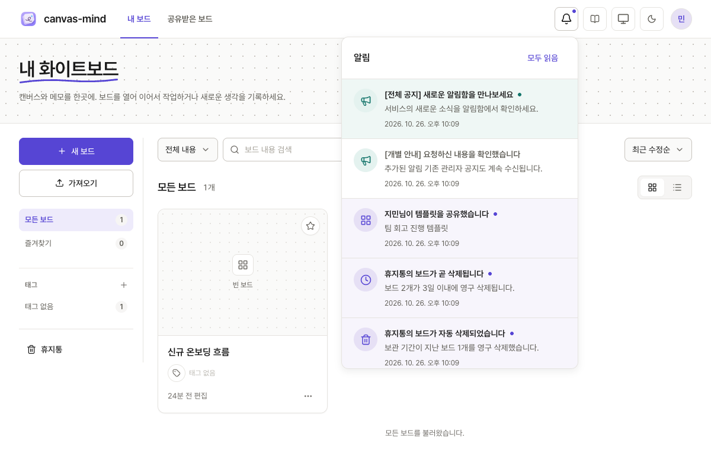](assets/screenshots/notification-inbox.png) |
| Claude Code·Codex·OpenCode 같은 외부 AI가 허용된 로컬 보드를 읽고 편집하도록 연결합니다.                                                                | 온라인 알림함에서 공지와 댓글·공유 소식을 확인하고 받을 알림을 선택합니다.                                                                                |

## 주요 기능

### 캔버스와 보드 관리

| 기능                   | 할 수 있는 일                                                                                                                               |
| ---------------------- | ------------------------------------------------------------------------------------------------------------------------------------------- |
| ✏️ **자유로운 캔버스** | 도형, 화살표, 텍스트, 이미지로 아이디어를 표현합니다. 아이콘과 도형 라이브러리를 활용하고 밝은 화면·어두운 화면을 선택할 수 있습니다.       |
| 🧭 **넓은 보드 탐색**  | 미니맵으로 원하는 위치로 이동하고, 자주 보는 화면을 북마크로 남깁니다.                                                                      |
| 🗂️ **보드 정리**       | 카드·목록 보기, 제목·내용 검색, 태그, 즐겨찾기로 여러 작업을 관리합니다. 온라인에서 삭제한 보드는 휴지통에서 30일 안에 복구할 수 있습니다.  |
| 🧩 **업무 템플릿**     | 6개 카테고리의 90개 기본 템플릿을 미리 보고 추가합니다. 내 템플릿을 저장하거나 온라인에서 다른 구성원에게 공유할 수도 있습니다.             |
| 📝 **보드 본문**       | Markdown으로 설명·표·체크리스트·수식·Mermaid를 작성하고 이미지를 첨부합니다. 연속 미리보기와 버전 기록·복원, MD·PDF·HTML 저장을 지원합니다. |

### AI와 외부 도구 연결

| 기능                       | 할 수 있는 일                                                                                                                          |
| -------------------------- | -------------------------------------------------------------------------------------------------------------------------------------- |
| ✨ **AI 작업·이미지 생성** | 자연어로 새 그림이나 기존 보드의 수정을 요청합니다. 초안을 미리 보고 적용하며, 지원되는 AI 연결에서는 이미지도 생성해 보드에 넣습니다. |
| 🔌 **외부 AI 연결·MCP**    | 외부 AI 에이전트에 온라인 계정의 보드나 이 컴퓨터의 로컬 보드를 연결합니다. 연결마다 읽기·편집 권한과 접근 범위를 정합니다.            |

AI는 선택 기능입니다. 온라인에서는 **기본 제공 AI 또는 개인 API 키**를 선택하고, 데스크톱에서는 설치·로그인한 **Claude CLI·Codex CLI**도 이용할 수 있습니다. 로컬 모드의 앱 내 AI 작업은 CLI 연결을 사용합니다. 기본 제공 AI에는 일간·주간 사용량 제한이 있으며 이미지 생성은 제공량을 더 많이 소모합니다. [AI 작업 안내](https://canvas-mind-docs.vercel.app/guides/07-ai-workspace/)에서 이용 방식을 확인하세요.

외부 AI에서 보드를 다루려면 [온라인 MCP](https://canvas-mind-docs.vercel.app/guides/14-mcp-agent-integration/) 또는 [데스크톱 로컬 MCP](https://canvas-mind-docs.vercel.app/guides/25-desktop-local-mcp/)를 설정합니다. 로컬 MCP는 같은 컴퓨터에서만 연결하며, AI 모델의 오프라인 실행을 뜻하지는 않습니다. 외부 AI의 로그인·인터넷 연결·요금은 사용하는 서비스에 따릅니다.

### 공유와 협업

| 기능                      | 할 수 있는 일                                                                                                                               |
| ------------------------- | ------------------------------------------------------------------------------------------------------------------------------------------- |
| 🤝 **온라인 공동 편집**   | 지정한 사람마다 보기·댓글·편집 권한을 정합니다. 편집 권한을 받은 사람은 같은 캔버스를 수정하고 참여자 목록과 이름표 커서를 확인합니다.      |
| 💬 **위치별 댓글**        | 캔버스 위치·요소에 댓글을 남기고 답글·이모지 반응으로 의견을 나눕니다. 해결한 대화는 정리하고 필요하면 다시 엽니다.                         |
| 💻 **데스크톱 로컬 작업** | 내 컴퓨터에 보드를 저장하고 오프라인으로 편집합니다. 같은 네트워크에서 편집을 허용하고 채팅·리액션·투표와 공유 기록 HTML 백업을 활용합니다. |

### 발표와 파일 활용

| 기능                       | 할 수 있는 일                                                                                                                                 |
| -------------------------- | --------------------------------------------------------------------------------------------------------------------------------------------- |
| 🎞️ **프레임 발표**         | 프레임별 Markdown 노트를 준비하고 현재·다음 프레임과 타이머를 보며 발표합니다. 별도 청중 창에 확대·레이저·필기를 동기화합니다.                |
| 📊 **PowerPoint 내보내기** | 보드 전체·선택 영역·발표 순서의 프레임을 PPTX로 저장합니다. 지원되는 도형·텍스트·화살표를 개별 편집하고 프레임 노트를 발표자 노트로 넘깁니다. |
| 📦 **파일·문서 내보내기**  | Excalidraw 파일을 가져오고, 캔버스를 PNG·SVG·프레임 ZIP·PDF·HTML로 저장합니다. 본문과 과거 본문 버전도 MD·PDF·HTML로 내보냅니다.              |
| 🧜 **Mermaid**             | Mermaid 코드를 편집 가능한 캔버스 요소로 삽입하고, 보드 전체·선택 영역을 flowchart 코드로 미리보기·복사·저장합니다.                           |

### 알림과 앱 보호

| 기능                    | 할 수 있는 일                                                                                                                               |
| ----------------------- | ------------------------------------------------------------------------------------------------------------------------------------------- |
| 🔔 **알림함·트레이**    | 온라인 공지·댓글·공유 소식을 알림함에서 확인합니다. 데스크톱은 창을 닫아도 트레이에 남고, 읽지 않은 소식을 배지와 시스템 알림으로 알립니다. |
| 🔒 **데스크톱 앱 잠금** | 수동·유휴·PC 잠금 연동을 설정하고, 지원 기기에서는 Touch ID·Windows Hello 등 OS 인증으로 해제합니다.                                        |

## 웹과 데스크톱 이용 방식

| 이용 방식                  | 이런 상황에 어울립니다                        | 보드 이용                                        |
| -------------------------- | --------------------------------------------- | ------------------------------------------------ |
| **웹**                     | 설치 없이 브라우저에서 시작할 때              | 로그인한 계정의 온라인 보드를 이용합니다.        |
| **데스크톱 · 온라인 모드** | 별도 앱에서 온라인 작업을 이어갈 때           | 웹에서 사용하던 계정의 온라인 보드를 이용합니다. |
| **데스크톱 · 로컬 모드**   | 내 컴퓨터에 보관하거나 오프라인에서 작업할 때 | 로그인 없이 로컬 보드를 만들고 편집합니다.       |

> [!NOTE]
> 로컬 보드는 온라인 보드나 다른 기기로 자동 동기화되지 않습니다. 온라인으로 옮길 때는 별도 가져오기를 이용합니다. 캔버스는 자동 저장되며, 본문을 수정한 뒤에는 **본문 저장**을 눌러 주세요.

**온라인 공동 편집**은 서로 다른 네트워크에서도 이용할 수 있습니다. 소유자가 **지정한 사용자만**으로 공유하고 사람별 **편집** 권한을 부여합니다. 공동 편집은 캔버스에 적용되며, 공유된 본문은 읽기만 가능합니다. 자세한 권한과 참여 방법은 [온라인 공유 가이드](https://canvas-mind-docs.vercel.app/guides/08-online-sharing/)를 확인하세요.

**데스크톱 로컬 공유**의 공동 편집·채팅·투표·리액션은 방장과 참여자가 **같은 LAN 또는 Wi-Fi**에 연결되어야 합니다. 방 코드와 비밀번호만으로 다른 네트워크에서 참여할 수는 없습니다. [로컬 공유 가이드](https://canvas-mind-docs.vercel.app/guides/16-desktop-local-share/)에서 준비 사항을 확인하세요.

## 시작하기

### 웹에서 이용

[canvas-mind 웹 앱](https://canvas-mind.vercel.app)에 접속해 로그인한 뒤 보드를 만들어 보세요. 빈 캔버스에 직접 그리거나, 템플릿을 골라 첫 작업을 시작할 수 있습니다.

### 데스크톱 앱 다운로드

[최신 GitHub Release](https://github.com/wally-wally/canvas-mind-release/releases/latest)에서 내 컴퓨터에 맞는 설치 파일을 내려받으세요. 각 버전의 변경 사항과 설치 안내도 릴리스 페이지에서 확인할 수 있습니다.

| 운영체제            | 설치 파일       | 설치 방법                                                                        |
| ------------------- | --------------- | -------------------------------------------------------------------------------- |
| macOS Apple Silicon | `.dmg`          | 앱을 응용 프로그램 폴더로 복사합니다. Intel Mac용 설치 파일은 제공하지 않습니다. |
| Windows x64         | `x64-setup.exe` | 설치 파일을 실행합니다. 관리자 권한은 필요하지 않습니다.                         |

macOS 앱은 Apple Developer ID 서명과 공증을 받았습니다. Windows 설치 파일에는 OS 코드 서명이 없어 SmartScreen 경고가 나타날 수 있습니다. 공식 릴리스에서 받은 파일인지 확인한 뒤 **추가 정보 → 실행**으로 진행할 수 있습니다.

설치 후에는 **설정 → 앱 업데이트** 또는 트레이 메뉴의 **업데이트 확인**에서 새 버전을 확인하고 설치합니다. 업데이트 전에 열린 작업을 저장해 주세요. 트레이 메뉴의 **canvas-mind 종료**로 앱을 완전히 끝낼 수 있습니다.

### 자세한 사용법

[공식 이용 가이드](https://canvas-mind-docs.vercel.app)에서 실제 화면과 함께 사용법을 확인할 수 있습니다.

- [온라인 공유·사람별 권한·공동 편집](https://canvas-mind-docs.vercel.app/guides/08-online-sharing/)
- [프레임 노트·발표자 보기·청중 화면](https://canvas-mind-docs.vercel.app/guides/10-frame-presentation/)
- [파일·HTML·PowerPoint·Mermaid 내보내기](https://canvas-mind-docs.vercel.app/guides/21-file-library-export/)
- [데스크톱 AI·CLI 연결](https://canvas-mind-docs.vercel.app/guides/18-desktop-ai-cli/)
- [데스크톱 로컬 MCP·외부 AI 연결](https://canvas-mind-docs.vercel.app/guides/25-desktop-local-mcp/)
- [데스크톱 앱 잠금·OS 인증](https://canvas-mind-docs.vercel.app/guides/24-desktop-app-lock/)

---

  <strong>떠오른 생각을, 다음 행동으로.</strong> 
  <a href="https://canvas-mind.vercel.app">웹에서 시작하기</a> ·
  <a href="https://github.com/wally-wally/canvas-mind-release/releases">데스크톱 다운로드</a> ·
  <a href="https://canvas-mind-docs.vercel.app">공식 이용 가이드</a>

